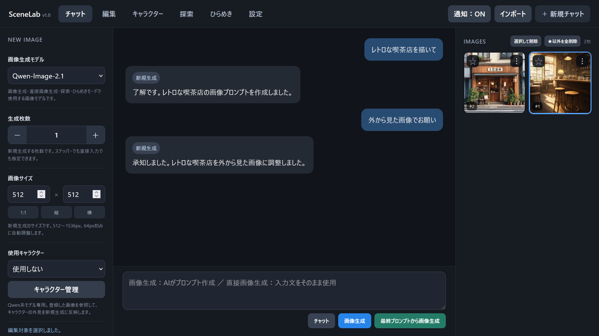
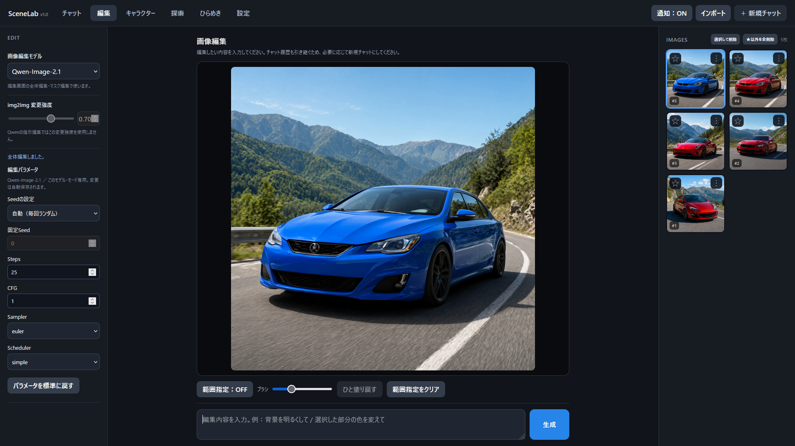
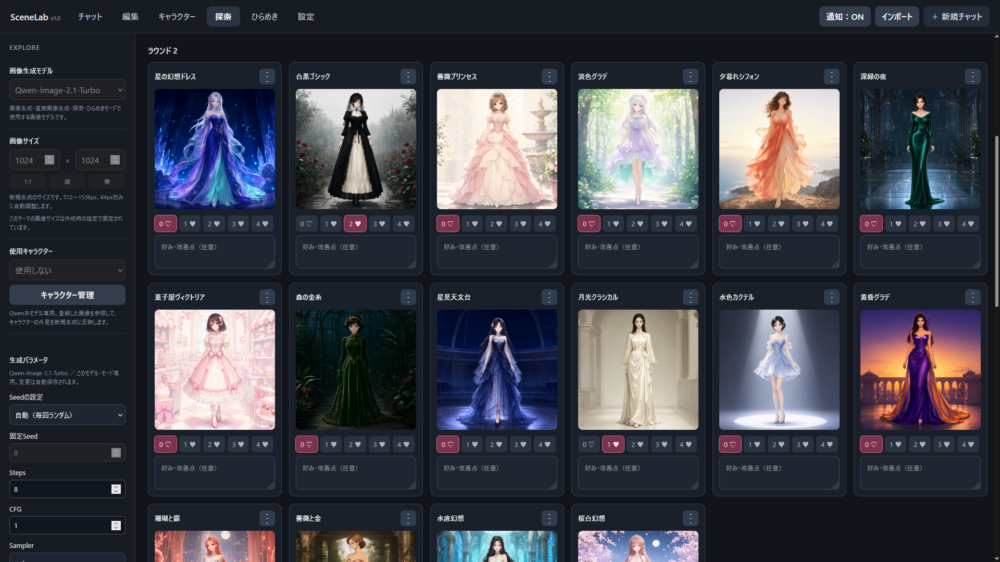
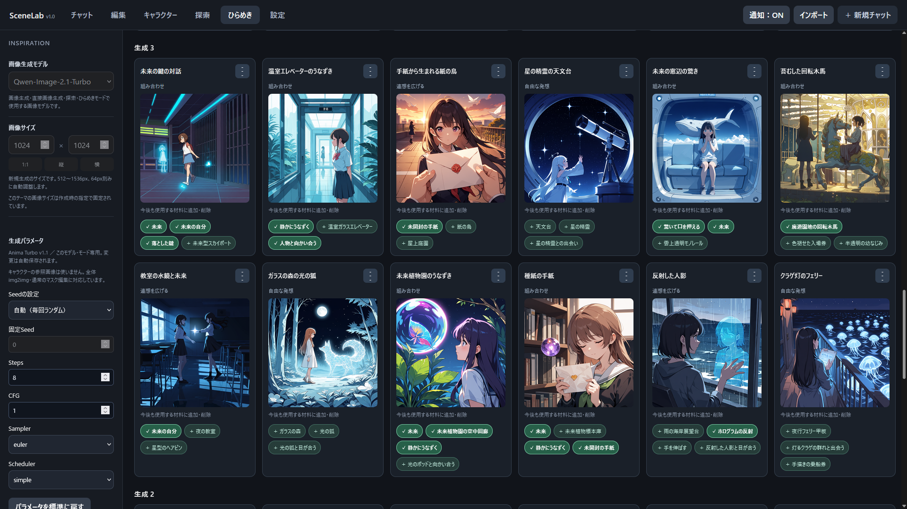

# SceneLab

日本語で相談しながら画像生成・編集。LLMとComfyUIをつなぐローカルアプリ。

SceneLabはWindowsのPCで起動し、ブラウザーから操作します。LLMがプロンプト作成を、ComfyUIが画像生成・編集を担当します。LLMの接続先はローカルサーバーとクラウドAPIから選べます。



## 主な機能

- **チャット・画像生成**：日本語でプロンプトを作成して画像を生成できます。最終プロンプト（画像生成モデルに直接渡す指示文）を入力して、そのまま画像を生成することもできます。生成枚数を複数枚にすると、同じ最終プロンプトでシードだけを変えて生成します。生成した画像は画面右側のギャラリーに保存・表示され、画像を選んで編集したり、プロンプトを確認したりできます。
- **画像編集**：画像全体、または範囲を指定して編集できます。
- **キャラクター**：名前・外見メモ・参照画像を登録できます。参照画像による新規生成はQwen系に対応しています。
- **探索**：テーマに沿って複数のプロンプトから様々な画像を生成します。つけたハート評価やコメントは、次のラウンドの生成に反映されます。
- **ひらめき**：テーマから発想の材料を用意し、組み合わせ・連想・自由な発想で様々な画像を作ります。

## 必要なもの

- WindowsとPython（開発時の確認環境：Python 3.12）
- ブラウザー
- 使用する画像モデルと必要なノードを導入したComfyUI
- ローカルLLM（Ollama、LM Studio、Strataなど）またはOpenAI互換API対応のクラウドサービス

SceneLab本体はPython標準ライブラリのみを使用し、追加の `pip install` は不要です。ComfyUI・LLMサーバー・モデルは別途用意してください。

## はじめ方

1. このリポジトリの **Code → Download ZIP** から取得し、展開します。
2. ComfyUIを起動します。ローカルLLMを使用する場合は、そのサーバーも起動します。
3. 展開したフォルダー直下の **`Start-SceneLab.bat`** を実行します。
4. 開いた画面の「設定」で、LLMのAPI URL・モデルIDとComfyUIの接続先を指定します。
5. 使用する画像モデルのファイルと対応状況を確認し、まずは画像1枚から試してください。

ブラウザーが開かない場合は、起動時に表示されるコンソールウィンドウのURLを開いてください。通常は `http://127.0.0.1:8765/` です。

モデルの配置先・必要ノード・接続設定・VRAM設定・トラブル対処は、[詳しい説明書](app/README.txt)にまとめています。

## 標準対応モデル

- Qwen-Image-2.1 / Qwen-Image-2.1-Turbo
- FLUX 3 Image Klein（Distilled INT8）
- SDXL（標準：Juggernaut XL Ragnarok／他の一体型チェックポイントへ差し替え可）
- Z-Image Turbo
- Anima Aesthetic v1.1 / Anima Turbo v1.1

キャラクターの参照画像を使った新規生成は、Qwen-Image 2.1/Turboのみ対応しています。

上記以外も、任意のモデルを追加登録することが可能です。

必要なファイル名・ノード・登録方法は[詳しい説明書](app/README.txt)を参照してください。モデル重みは同梱していません。

## フォルダー構成と保存データ

```text
SceneLab/
├─ README.md
├─ LICENSE
├─ Start-SceneLab.bat   ← 起動用
├─ app/            ← 本体・詳細説明書・外部ライセンス
└─ data/           ← 設定・作品（起動時に自動作成）
```

通常の操作はブラウザーで行います。設定・画像・キャラクター・探索・ひらめきのデータは `data/` に保存します。

更新するときは、これまで使っていた `data/` フォルダーを新しい版のフォルダーへコピーすると、設定や作品を引き継げます。バックアップも `data/` を丸ごとコピーするだけです。

## スクリーンショット

### 画像編集



### 探索



### ひらめき



## 利用範囲

Windows上で、同じPCのブラウザーから操作する用途を対象としています。インターネットに公開するサーバー運用や複数ユーザー運用は対象外です。

クラウドLLMを選ぶと、会話・テーマ・材料・キャラクターのメモなどのLLM入力が接続先へ送信されます。保存したAPIキーはWindowsのDPAPIで暗号化します。

## ライセンス

SceneLab本体は[MITライセンス](LICENSE)です。

公式ワークフロー由来の部分の出所・著作権表示・条件は[Third-party notices](app/THIRD_PARTY_NOTICES.md)と[同梱ライセンス全文](app/LICENSES/)を参照してください。

外部ソフト・モデルにはそれぞれの条件が適用されます。特にQwen-Image 2.1/Turbo・Anima・FLUX 3 Kleinは独自の利用条件があり、SceneLab本体のMITとは別です。取得・利用するモデルのライセンスを確認してください。
